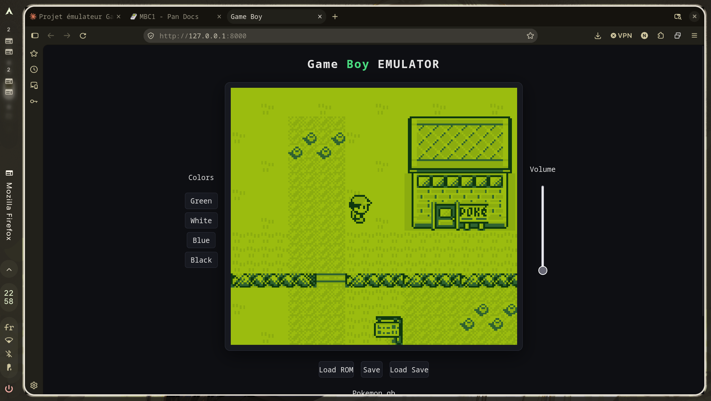

# Game Boy Emulator

This project is a Game Boy emulator, living in your browser with WebAssembly

No ROMs included.
Game Boy (DMG) only

Big thanks to:

https://gbdev.io/pandocs/About.html to understand how its built
https://github.com/retrio/gb-test-roms whithout wich i would probably never debugged that CPU


**▶ [Try it in your browser](https://kingofpottatoes.github.io/CHIP-8/)**




## Features

- Fully working CPU
- MBC1 and MBC3 implemented
- Sound
- Keys remap (because thats better)
- Loading your own Rom (to try your own Roms)
- Save your own saves (to keep playing)
- Web Export with WebAssembly

## Whats not here yet

- no Color support. 
- MBC2 and MBC5 are not supported yet.

## Controls

Key are mapped by physical position using Raylib

On the web version you can remap them like you want

## Building

### Desktop

Requirements: `gcc`, `make`, [raylib](https://www.raylib.com/)

then:

```bash
make
./gb path/to/rom.gb
```

### Web

Requirements: [Emscripten](https://emscripten.org/), raylib compiled for the web

```bash
make web
cd docs && python -m http.server
```

finally open the website on http://localhost:8000

## Known Issue

Currently, the channel 3 have a slight low-frequency buzz at high volume, i will search for why, but that really strange and hard